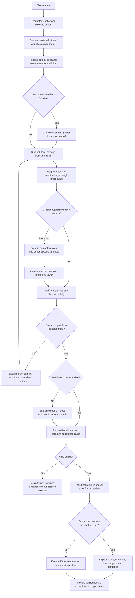

# Slicing workflow, hierarchy and handoff

Read for a new slice job or when intent/settings change. `FDM-Slicing.md` owns policy; `Project.md` owns verified design/job facts; `Printers.json` owns portable hardware/presets. Load the selected records and relevant procedures only. Installed profiles do not establish ownership or user intent.

Follow the shared [application-session lifecycle](../../application-session/references/lifecycle.md) for unused jobs/windows, usage-limit checkpoints and 12-hour maintenance. Preserve a native editable job as well as slice outputs. After a confirmed restart, rebind the selected app's real process, restore its saved project/plate/profiles and verify the pending preview before continuing the same job.

## Responsibilities

| Responsibility | Owner and handoff |
| --- | --- |
| Intent and exceptions | `Project.md` supplies function, loads, critical geometry, orientation and version purpose. Apply `FDM-Slicing.md`; record a design-intent exception by rule ID and reason. |
| Job coordination | `orca-slice` handles user slicer choice, headless preparation/slicing, non-disruptive UI preview and durable results through this workflow. |
| Native settings | [Settings](settings.md) translates policy, resolves feature conflicts and checks effective values. |
| Adaptive layers | [Layer height](layer-height.md) generates/verifies the required smoothed height schedule, shell coverage, support compatibility and flow. |
| Conditional support detail | Read [support materials](support-materials.md) only to propose/apply a second interface material or diagnose swap-layer effects. |
| Application mechanics | [Startup](startup.md) covers discovery, Store/desktop activation, UI access and optional MCP. |
| Hardware or preset changes | `printer-library` defines/migrates the machine/presets; return after verifying compatibility. |
| CAD review or edits | `fusion-print` reviews orientation, overhangs and fits; `fusion-model` handles authorized parametric changes. Re-export after a CAD change. |
| Physical evidence | `fdm-calibrate` owns measured temperature/flow/adhesion/fit tuning; estimates cannot establish strength or bonding. |
| Estimated comparisons | `slice-compare` controls variables and restores/adopts a verified baseline. Keep intermediate slices headless; preview the selected final result. |

## Decision flow



The slice node includes a verified GUI/MCP fallback; do not call it headless. Missing approval is not a retry loop: keep the concrete proposal pending and continue independent preparation. If declined, retain the single-material baseline. An unresolved capability conflict stops dependent slicing; propose a compatible route/build, separate plates or a specific decision without installing/switching apps or disabling a requirement implicitly.

## Prepare, execute and review

1. **Choose the app and job purpose.** Discover installed slicers and obtain the choice under `FDM-Slicing.md`, then probe only that build. Reuse verified context and existing approvals rather than repeating questions. Resolve fit test, structural test or user-declared final; high infill requires that final designation. A general slice request does not approve a second interface material.
2. **Establish the current source.** For Fusion exports, record saved document/version, selected bodies/components, export path/hash, units and bounding dimensions. Establish plate, object count, millimeter dimensions, orientation, printer/nozzle, filament slots and resolved settings from verified file/CLI inspection. Keep CAD changes in the parametric source and invalidate prior exports/slices after a source change. Recheck geometry visually at preview.
3. **Build the job setup.** Apply policy through [settings](settings.md) and [layer height](layer-height.md). Preserve inherited profiles, global presets, unsaved overrides and approved orientation/interfaces, including mating, bearing and cosmetic surfaces identified in `Project.md`. Read back effective values after profile loading and normalization. For a second interface material, follow [support materials](support-materials.md): prepare the compatible plan before requesting its specific approval, then apply only the approved scope. Record exceptions and unresolved capabilities instead of replacing policy with a supposed optimum.
4. **Slice through the verified route.** Prefer CLI preparation and slicing without first opening the source model or an embedded MCP GUI. Explain any indispensable earlier UI setup and obey [non-disruptive access](startup.md#non-disruptive-ui-access). Wait for explicit completion and inspect the current logs/toolpaths. Preserve failed artifacts; do not silently retry with another app, default profiles or a stale output.
5. **Inspect the final UI preview.** Open this job's completed slice in the chosen app and enter layer/toolpath Preview if needed. Inspect shell/adjacent-solid patterns, stacked infill, dimensions/bed fit, orientation, supports/unsupported regions, layer heights, flow/cooling, material assignments, object order, warnings and estimates/units as applicable. A window or unsliced model is insufficient. Keep the exact unreadable or disruptive UI action pending and do not claim visual review. Activation mechanics and access limitations belong in [startup](startup.md).
6. **Save and hand off.** Save requested local 3MF/G-code. Record source/version/export hash; chosen app/server version; printer/nozzle/material; profile identifiers, parent dependencies, hashes and overrides; critical dimensions/loads/surfaces; job purpose and actual infill band; adaptive profile; transforms, plate/support/object order; approval scope and design-intent exceptions; warnings, estimates/units, outputs/hashes and pending checks in `Project.md` or its linked manifest. Keep reusable user preferences in `FDM-Slicing.md`. Distinguish exported toolpaths, UI opened, preview inspected and physical validation; none establishes the next. Estimates stay estimates. Printer uploads/physical operations need separate task authorization.

## Local CLI automation

Use `slicer.py probe --select ID` followed directly by `slice`, without a preceding `open`. The core helper requires the selected build to advertise `--slice`, `--export-3mf` and any requested profile-loading options. For a different CLI, inspect that executable's help and use a reviewed argument array; open its completed result for preview. Never infer support from a product name/version.

```powershell
# Verified job 3MF carrying accepted profiles, orientation and layer-height schedule.
py -3 .agents/skills/orca-slice/scripts/slicer.py slice --select ID --input 'Print Jobs\prepared.3mf' --embedded-profiles --plate 1 --output 'Print Jobs\job-sliced.3mf'
# Explicit exported native machine/process and filament JSON profiles.
py -3 .agents/skills/orca-slice/scripts/slicer.py slice --select ID --input 'Output CAD\part.stl' --settings 'Profiles\machine.json' --settings 'Profiles\process.json' --filaments 'Profiles\filament.json' --plate 1 --output 'Print Jobs\job-sliced.3mf'
```

Use actual paths/ID. Repeat `--executable PATH` for an unregistered portable install. `--embedded-profiles` asserts the agent has verified the prepared 3MF; it does not validate printer/nozzle/material automatically. Bare meshes require explicit machine/process and filament files. Preserve inheritance and selected-build compatibility; a preset display name is not a settings file. Loading JSON alone does not generate an adaptive/smoothed profile. Confirm plate numbering against the build's help: core CLI uses 0 for all plates and positive values for an individual plate. Do not add arrange/orient flags that override accepted placement. Establish significant raw-mesh placement/orientation from source/file inspection or a prepared project; explain any necessary earlier UI setup.

The helper runs in a fresh job directory beside the new output, captures `slice.log`, writes `result.json`, checks process success and nonempty G-code in the new 3MF, and records input/profile/output SHA-256 hashes. Existing outputs are refused to prevent stale-result reuse; choose a new job result name. Its CLI timeout stops its own headless invocation, never an existing GUI. Keep failure logs/output for inspection.

After those checks it opens the result in the same selected app and reports any opening error. Use `--no-open` for intermediate comparisons or to defer disruptive activation; later open the selected final artifact with `slicer.py open --select ID --file PATH` through a compliant route. Final visual review remains pending until inspected, unless the user explicitly overrides it. `toolpaths_exported` establishes file/process evidence only; logs and the actual preview still need review, and physical strength/fit/adhesion need measured tests.
